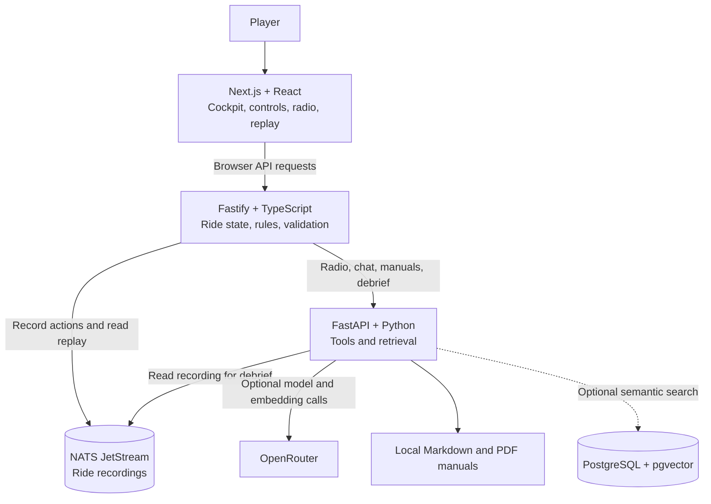

# Escape

**One bike. A storm coming. Your next move matters.**

Escape is a motorcycle road-trip game where a warning light becomes a decision. Pull over, inspect the bike, talk to Sparky over the radio, and choose your next move before the storm arrives.

It is also a hands-on full-stack learning project, bringing together TypeScript, Python, an AI mechanic, manual retrieval, and recorded ride events.

This repository documents the game and its engineering. The application source code is maintained privately. This documentation repository is private while the first version is being prepared.

[The game](#the-game) · [Architecture](#architecture) · [Inside a request](#inside-a-request) · [Sparky](#sparky-the-ai-mechanic) · [Infrastructure](#infrastructure) · [Engineering decisions](#engineering-decisions) · [Current status](#current-status) · [Source availability](#source-availability)

## The game

A Honda CBR600RR, a roadside problem, and three inspection minutes. Read the instruments, gather evidence, and decide whether to investigate, request help, or continue. The inspection budget advances through actions rather than a real-time countdown. Radio questions do not spend inspection minutes.

### Five roadside scenarios

| Level | Location | The challenge |
| --- | --- | --- |
| 1 · Overheating | Levee Road | Respond to a temperature warning and investigate a coolant leak. |
| 2 · Low oil pressure | Quarry Road | Check the oil level and confirm the warning clears before continuing. |
| 3 · Engine will not start | Roadside Stop | Investigate a silent starter and a blown fuse. |
| 4 · Tyre puncture | Gravel Bend | Investigate unstable handling and arrange tyre recovery. |
| 5 · ABS warning | Coast Road | Interpret the warning and arrange dealer inspection. |

The instrument cluster shows simulated speed, engine state, temperature, and warning lamps. Available controls change as the ride progresses. A symptom is visible before its cause is confirmed through inspection.

**Ask Sparky** opens the mechanic radio. Sparky can read the current dashboard and search the Honda manual. On a lost ride, **Open black box** shows the recording and a debrief explaining the outcome. A completed level lets the player retry, choose another level, or advance when another level is available.

The original **Night Garage** remains a separate demo with selected-bike chat and a fictional `C17` roadside scene.

Example ride · contains level 1 spoilers

The temperature lamp comes on while climbing Levee Road. Pull over, stop the engine, and wait for it to cool. Inspect the coolant: its level is low and a drop forms under the hose. Request assistance and report the coolant leak.

Recovery is dispatched. On a different run, continuing to ride leads to overheating and a stalled engine. The black box makes that decision visible in the replay.

## Architecture

**The browser shows the ride. Fastify decides what happens. Python helps Sparky explain it.**

| Component | Responsibility |
| --- | --- |
| **Next.js / React** | Render the dashboard, play sounds, show available actions, and display mechanic replies and manual passages. Forward browser API requests to Fastify. |
| **Fastify / TypeScript** | Own active rides, validate player actions, apply game rules, record events, and supply ride facts to Python. |
| **FastAPI / Python / Pydantic** | Validate AI inputs, run the model and tool loop, retrieve manual evidence, and explain recordings. |
| **NATS JetStream** | Persist ride events for replay and debrief. TypeScript and Python read the same recording independently. |
| **PostgreSQL + pgvector, optional** | Store and search embedded manual passages. It does not store active game sessions. |

Sparky's tools are read-only. Asking about coolant does not inspect it or spend a minute. Pressing **Inspect coolant** sends a player action that Fastify must validate and apply.

## Inside a request

### A player inspects the coolant

1. The browser sends `POST /api/rides/:id/actions` with `{ "action": "Inspect coolant" }`.
2. Next.js forwards the request to Fastify.
3. Fastify checks that the ride exists and the action is available at its current stage.
4. It calculates the next state on a copy of the ride, including the inspection finding and remaining budget.
5. NATS JetStream acknowledges the recorded event.
6. Fastify updates the active state and returns the dashboard for the browser to render.

An unavailable action returns `409`. A recording failure returns `503` rather than accepting an unrecorded move. Ride creation also depends on the recorder being available.

### A rider asks about a warning

1. The browser sends the question to Fastify's ride radio endpoint.
2. Fastify selects the ride and supplies its dashboard readings and inspection findings to Python.
3. The model can request `get_ride_status` and `search_honda_manual`.
4. Python runs the requested tools and returns their results to the model. The SDK matches tool outputs to their call IDs.
5. The browser receives the reply and any retrieved manual passages with PDF page references.

The browser supplies the question. The game API supplies the ride facts used by the mechanic.

### A lost ride gets explained

Fastify publishes ride events to a subject of the form `rides.<ride-id>`. The black box reads them into a timeline. Python independently reads the recording to construct the debrief.

The recorded actions, findings, and final state determine the verdict. An optional model call can select a coaching tip from approved candidates; it does not change the recorded outcome.

## Sparky, the AI mechanic

Sparky connects a language model to two sources of evidence: the current ride and the motorcycle manual.

| Tool | What it provides |
| --- | --- |
| `get_ride_status` | Simulated speed, engine state, coolant temperature, warning lamps, and findings already collected by the player. |
| `search_honda_manual` | Up to three passages from the English 2024 Honda CBR600RR owner's manual, with passage numbers and PDF pages. |

For a question such as **“What does this warning light mean?”**, Sparky can read which lamp is on and retrieve the relevant manual passages. The instructions distinguish a possible cause from a finding the player has actually confirmed.

### Manual retrieval

The Honda search supports three paths, tried in order:

1. **PostgreSQL + pgvector**, when configured and matching passages are available.
2. **Saved local embeddings**, when a local index exists.
3. **Local word search**, when no local embedding index exists.

An embedding represents text as a list of numbers so that a question can be compared with manual passages by meaning. For example, a starting problem can match a passage about the sidestand even when the question uses different words.

Semantic search uses OpenRouter to embed the question. The radio model is instructed to cite retrieved passage numbers; the interface can show the excerpts and open the source PDF at the corresponding page. Retrieval supplies evidence at request time rather than training the model on the manual.

The Night Garage uses a separate exact Markdown lookup for fictional game codes such as `C17`. Those codes belong to the Escape game manual.

### Limits and fallback behavior

The radio tool loop is bounded and has a timeout. Without a provider key, or when the request fails, the ride radio reports that it is offline. The player can still use the game controls while the required game services are available.

The original garage chat has local fuel and engine rules as a fallback. The black box debrief can explain recorded outcomes without a model key.

Retrieved passages do not guarantee that every generated statement is correct. Sparky is a character in a scripted game; the current dashboard and inspection results are simulated.

## Infrastructure

The development setup uses three application services and a recorder:

| Service | Local port | Role |
| --- | --- | --- |
| Next.js | `3000` | Browser entry point. |
| Fastify | `3001` | Game API and AI gateway. |
| FastAPI | `8000` | Mechanic and manual service. |
| NATS JetStream | `4222` | Ride event storage and replay. |

The Docker configuration defines separate web, API, AI, and NATS containers. Within that configuration, the web service targets `api:3001`, the API targets `ai:8000`, and both backends use `nats:4222`. The web port is published; the API and AI stay on the container network. NATS is exposed on host loopback for local access.

**Current deployment limitation:** Fastify still binds to `127.0.0.1`. The Compose configuration sets `API_HOST=0.0.0.0`, but the server does not yet read it. The full container stack needs that binding resolved before it can work as intended. This document describes the checked-in configuration, not a verified production deployment.

PostgreSQL is an optional external dependency for manual retrieval and is not part of the four-service Compose stack. OpenRouter is an external provider for model and embedding requests. Provider and database credentials stay in local environment configuration.

### What survives a restart?

| Data | Storage | Lifetime |
| --- | --- | --- |
| Active rides | Fastify memory | Lost when the API restarts. Finished rides are removed from the active map. |
| Ride recordings | JetStream file storage | Survive container restarts while the `ride-events` Docker volume remains. |
| Manuals | Local Markdown and PDF files in the application | Remain with the application files. |
| Manual embeddings | Optional local index or PostgreSQL | Reusable between searches; separate from ride state. |

The browser does not currently restore an active ride after reload. Deleting the recorder volume deletes its stored recordings.

## Engineering decisions

### Keep game state in Fastify

Player choices must be checked against the current ride stage. Fastify owns that state and applies accepted actions. Python receives facts for the mechanic to read. This keeps a model reply from directly applying a game action.

**Tradeoff:** active state is currently held in one process's memory. Restarts lose sessions, and multiple API instances would need a shared state strategy.

### Use Python for the mechanic and retrieval

The AI service groups Pydantic schemas, the OpenRouter Agent SDK, PDF text extraction, and manual search. HTTP separates it from the TypeScript game API.

**Tradeoff:** this adds a service to run and a network boundary to handle. Input validation and coordinated timeouts matter on both sides.

### Record decisions with NATS JetStream

The black box needs an ordered record that both TypeScript and Python can read. JetStream supplies persistent events and independent consumers for replay and debrief.

**Tradeoff:** the ride depends on recorder availability. Active rides still use memory; recording events does not yet provide automatic session restoration.

### Retrieve manual passages when answering

Manual retrieval gives Sparky specific excerpts and page references to use in its reply. The search path can start with local word matching and use embeddings when configured.

**Tradeoff:** search quality depends on PDF extraction and passage selection. Semantic similarity is not proof that an answer is supported, and embedding requests add provider cost and latency.

## Current status

Escape is an evolving demo and learning project. This first documentation version reflects the local implementation reviewed on **20 November 2026**, including work that is still in progress in the application repository.

**Implemented in the current local code**

- Five selectable Honda roadside scenarios with simulated instruments, engine sounds, inspections, and outcomes.
- Ride radio with read-only dashboard and Honda manual tools.
- Event recording, a black box shown after a loss, and a recording-based debrief.
- The original Night Garage chat and fictional `C17` manual scene.
- Optional local and PostgreSQL-backed manual embeddings.
- Docker build targets and a Compose configuration, with the API binding limitation described above.

**Current limits**

- Active sessions are held in memory and are not restored after restart or browser reload.
- Scenarios and findings are scripted, rather than a physical motorcycle simulation.
- Model-backed radio replies require provider access.
- The full container deployment has not been verified by this documentation work.
- This repository does not yet include gameplay captures or a public demo link.

**Next documentation work**

- Capture the cockpit, radio with manual citations, and a black box replay.
- Add a short gameplay recording near the top of this page.
- Update deployment details after the full stack has been checked.

## Source availability

This repository contains Escape's presentation, architecture, and engineering notes. It is private during preparation. Making this documentation public later requires an explicit decision.

The application source is maintained in a separate private repository. This documentation does not include the application implementation, credentials, or motorcycle manual PDFs.
