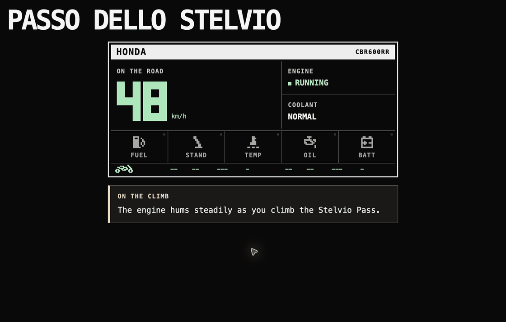
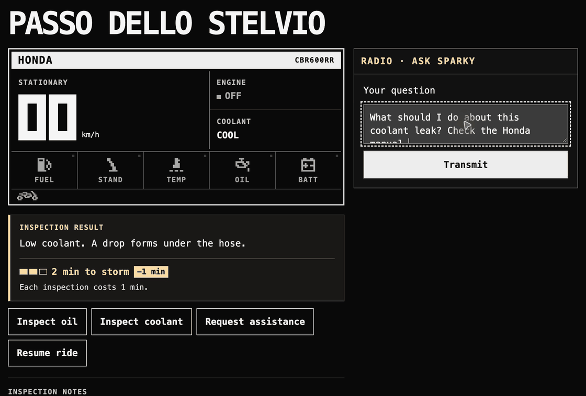
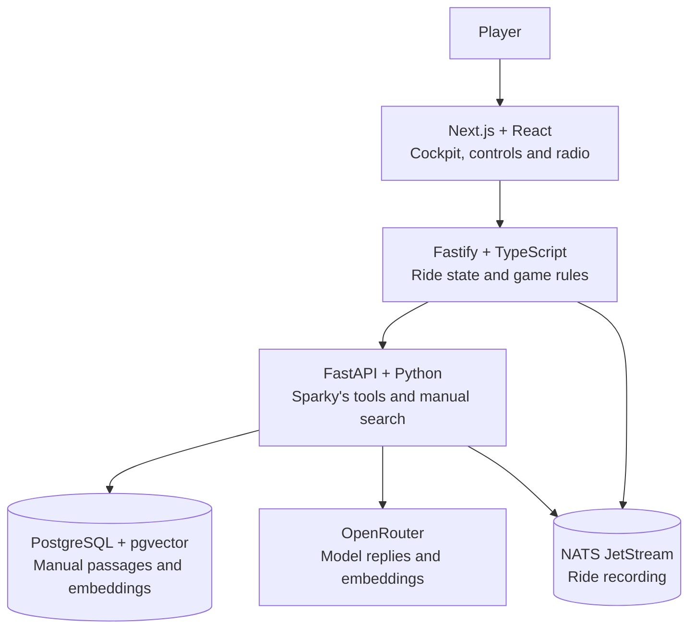
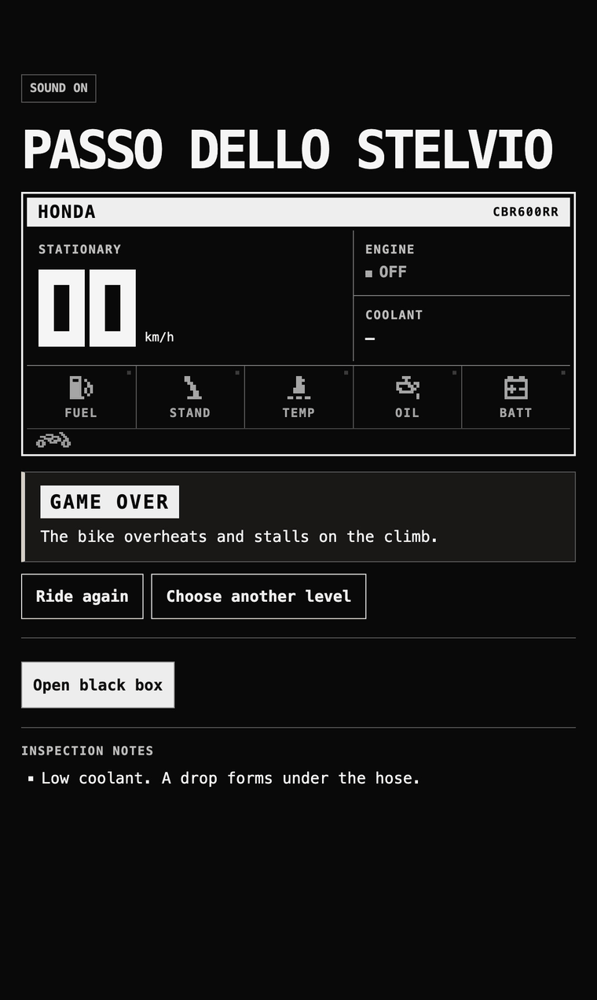

# Escape

Escape is a motorcycle road-trip game about figuring out what to do when the ride doesn't go to plan. You're heading up Passo dello Stelvio on a Honda CBR600RR when the bike starts acting up, with a storm getting closer and your mechanic, Sparky, at the other end of the radio.

Read the instruments, pull over to investigate, and talk it through before deciding what to do next. The game grew out of learning full-stack development and finding a useful place for Python, language models, and a searchable motorcycle manual in the same project.

[The ride](#the-ride) · [Sparky](#talking-with-sparky) · [Manual search](#looking-things-up-in-the-manual) · [Architecture](#how-it-fits-together) · [Black box](#remembering-the-ride)

## The ride

The dashboard gives you clues about what the bike is doing, while inspections help you work out why. The controls change with the situation, and each inspection takes a minute from the time you have before the storm. You can ask Sparky as much as you need without spending inspection time.

The radio becomes available after the opening scene and keeps track of your recent conversation, so you can ask a follow-up without explaining everything again. Your progress and chat survive a refresh in the same tab, and **Clear progress** lets you start over. Finish a ride successfully and you can keep going; get stranded and the black box helps you understand how you got there.

The original **Night Garage** is still available from the starting screen as a separate mechanic-chat demo.

## Talking with Sparky

Sparky can read the dashboard, the findings you've collected, and the actions you can currently take. That lets him respond to your actual situation rather than give the same advice every time. He can suggest a button to press, but the decision stays with you and the game checks the move before applying it.

When you ask about something in the Honda manual, he can look it up and include a source in his reply. Clicking the citation opens the passage, with a link to its page in the original PDF.

## Looking things up in the manual

The manual search is already connected to the radio. The English Honda CBR600RR owner's manual is split into passages and stored in **PostgreSQL with pgvector**, alongside the text and PDF page numbers.

Each passage also has an **embedding**, a list of numbers used to compare meaning. When Sparky searches the manual, Python creates an embedding for the question and asks PostgreSQL for the three closest passages. Those excerpts go back to the model, which uses them to answer with references you can check.

For example, a question about a warning light can find the relevant manual section even if you describe it differently. This is retrieval-augmented generation, or **RAG**: the model gets useful evidence from the manual while answering. Local search is available as a fallback if the database cannot be reached.

The fictional codes in the Night Garage use a separate Markdown game manual.

## How it fits together

The browser displays the ride, Fastify runs the game rules, and Python connects Sparky to the ride facts and manual. NATS keeps a recording that both the game and the mechanic can read later.

| Component | What it handles |
| --- | --- |
| **Next.js / React** | Instruments, sound, player controls, conversation, and manual citations. |
| **Fastify / TypeScript** | Active rides, allowed actions, inspection results, and outcomes. |
| **FastAPI / Python / Pydantic** | Validated AI inputs, tool calls, retrieval, and ride explanations. |
| **PostgreSQL + pgvector** | Manual passages searched by meaning, with their source pages. |
| **NATS JetStream** | Recorded decisions for replay and debrief. |

For a player action, Fastify checks the current stage, calculates the next state, and records the event before accepting the move. For a radio question, it supplies the current ride facts to Python, where the model can request dashboard or manual tools. Those tools only read information; they don't change the ride.

## Remembering the ride

The black box turns a lost ride into a timeline of decisions and findings. Sparky reads that same recording to explain what happened and suggest something to try next time. The recorded actions determine the outcome; the model can help choose a coaching tip.

Watch a black box replay

Active rides live in Fastify memory, while the browser saves enough information to reconnect after a refresh and restore the conversation. Restarting the API expires active rides. NATS recordings survive container restarts in a persistent volume, and PostgreSQL keeps the manual passages separately.

## Development notes

Escape is a playable demo with simulated instruments and scripted roadside situations. Radio replies use OpenRouter; when it is unavailable, you can still use the game controls. The original garage has local chat rules, and the debrief can explain recorded outcomes without a model key.

Docker Compose defines the web, API, AI, and NATS services, with PostgreSQL hosted separately. The full container setup still needs Fastify's host binding connected to the Compose setting before deployment; these captures show the local game.

This repository contains the presentation and engineering notes. The application source remains in a separate private repository; credentials and motorcycle manual PDFs are not included here.

*Project notes · August 2026*
